# AK-OS · Ground Station

**The portfolio of Ahraz Kibria, software and AI engineer in Toronto.** Live at **[hireahraz.dev](https://hireahraz.dev)**.

The site is drawn like an engineering sheet and runs like a mission-control console. The name in the hero is liquid metal that follows your cursor. Every project card is a working instrument rather than a screenshot, and each project opens into a full write-up with a generated system-design diagram.

It is a static site with no framework and no build step: hand-written HTML, CSS, vanilla JavaScript and raw WebGL.

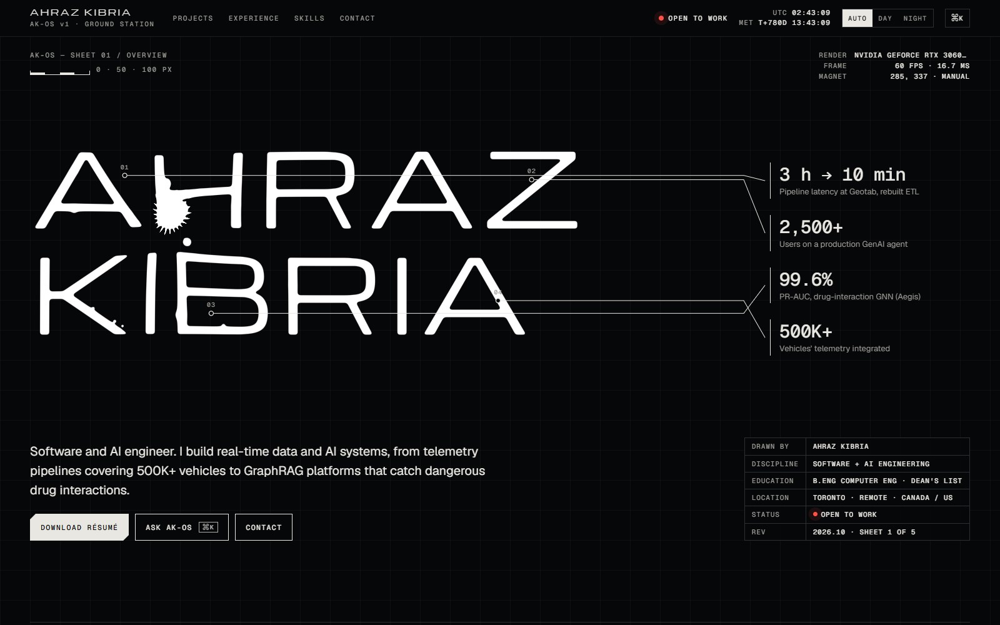

<p align="center">
  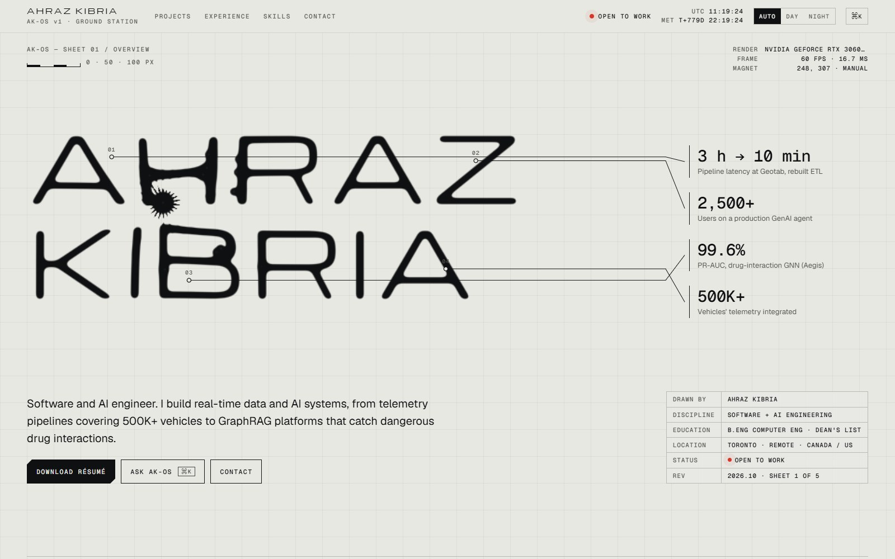
  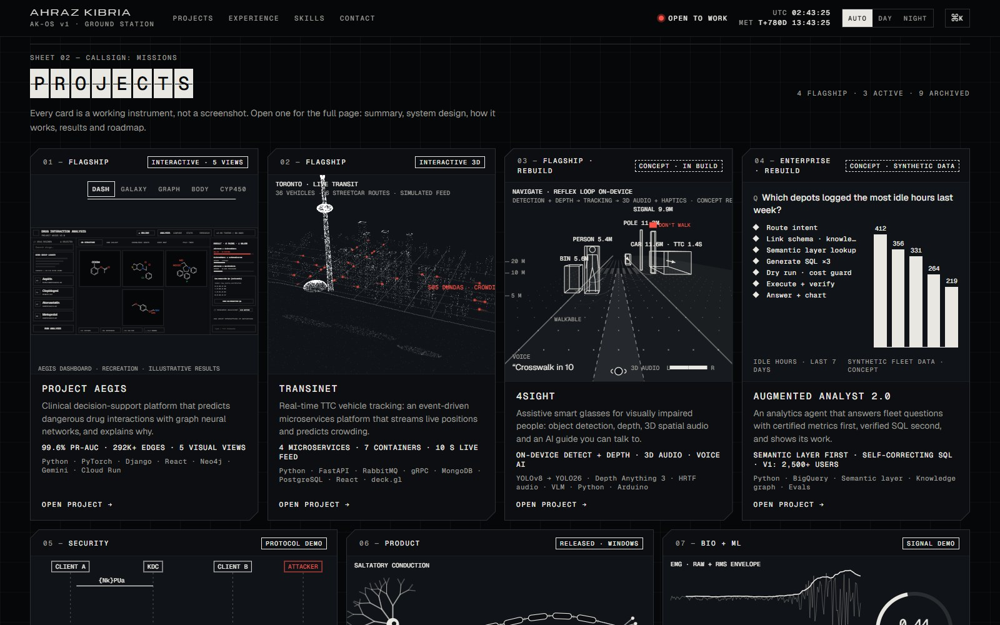
</p>

---

## Contents

- [What's on the site](#whats-on-the-site)
- [Screenshots](#screenshots)
- [How it works](#how-it-works)
- [Project structure](#project-structure)
- [Run it locally](#run-it-locally)
- [Editing content](#editing-content)
- [Deploying](#deploying)
- [Roadmap](#roadmap)
- [Credits](#credits)

---

## What's on the site

| Section | What it does |
| --- | --- |
| **Hero** | The name is rendered as a metaball field in WebGL. A spiky magnet follows the cursor (or your finger), pulls the letters toward it and peels off droplets. On a first visit a short intro drops the liquid in and settles it into the name. |
| **Projects** | Seven projects, each with its own live visualization on the card. Opening one gives a full page: summary, system design, how it works, demo, results, decisions and trade-offs, and what's next. Every project page has a shareable link, such as `#project/aegis`. |
| **Experience** | A horizontal timeline from university to now. Ink flows along it toward the next point. Select a point to read the role. |
| **Skills** | A 3D force graph that links skills to the projects and roles that prove them. Node size is the amount of evidence, not a self-rating. |
| **Job match** | Paste a job description and the site lists which requirements have shipped work behind them. It lights those skills up in the graph and recommends the best résumé version. It runs entirely in the browser. |
| **Command palette** | `⌘K` / `Ctrl+K` or `/` opens a palette for navigation, projects, themes and résumés. Ask AK-OS, the question-answering part, is in development. |
| **Résumés** | Six versions (Software, AI/ML, AI Data, Data Science, Cloud, Finance), each tuned for a different kind of role. |
| **Themes** | Auto, day and night. `T` cycles through them. |

### The projects

| # | Project | What it is | Stack |
| --- | --- | --- | --- |
| 01 | [Project Aegis](https://github.com/ahrazkk/ProjectAegis-Clinical-MLOps-Platform) | Clinical decision support that predicts drug-drug interactions with graph neural networks (99.6% PR-AUC) and shows the evidence. | PyTorch, Django, React, Neo4j, Gemini, Cloud Run |
| 02 | [TransiNet](https://github.com/ahrazkk/TransiNet---RealTime-GTA-transit) | Real-time TTC vehicle tracking across four event-driven microservices, with crowding prediction. | FastAPI, RabbitMQ, gRPC, MongoDB, PostgreSQL, deck.gl |
| 03 | [4Sight](https://github.com/ahrazkk/4Sight--AI-Powered-Vision-Assistance) | Assistive smart glasses for visually impaired people: object detection, depth and 3D spatial audio. V2 is in design. | YOLO, monocular depth, HRTF audio, VLM |
| 04 | Augmented Analyst 2.0 | An analytics agent that answers with certified metrics first and verified SQL second. V1 shipped at Geotab; V2 is an open rebuild on synthetic data. | BigQuery, semantic layer, knowledge graph, evals |
| 05 | [KDCore](https://github.com/ahrazkk/KDCore---Secure-Multi-Party-Cryptographic-Relay) | Secure multi-party chat: RSA handshakes, an AES group key from a key distribution center, signed messages and replay protection. | Java, RSA-2048, AES, SHA256withRSA |
| 06 | [Myelin](https://github.com/ahrazkk/myelin) | A Windows habit app that plans your day and lives on your wallpaper and lock screens. | Python, JavaScript, Lively Wallpaper |
| 07 | [BIOsync](https://github.com/ahrazkk/BIOsync--Advanced-Fitness-AI) | EMG signal processing and a neural network that predict muscle fatigue, with an AI coach. | Python, DSP, MLP, GPT |

Design docs for the two concept rebuilds are in [`docs/projects/`](docs/projects/).

---

## Screenshots

### Project pages

Each project opens into a full sheet. The visual at the top is live: Aegis has five views of one system, and TransiNet is a point-cloud Toronto you can orbit.

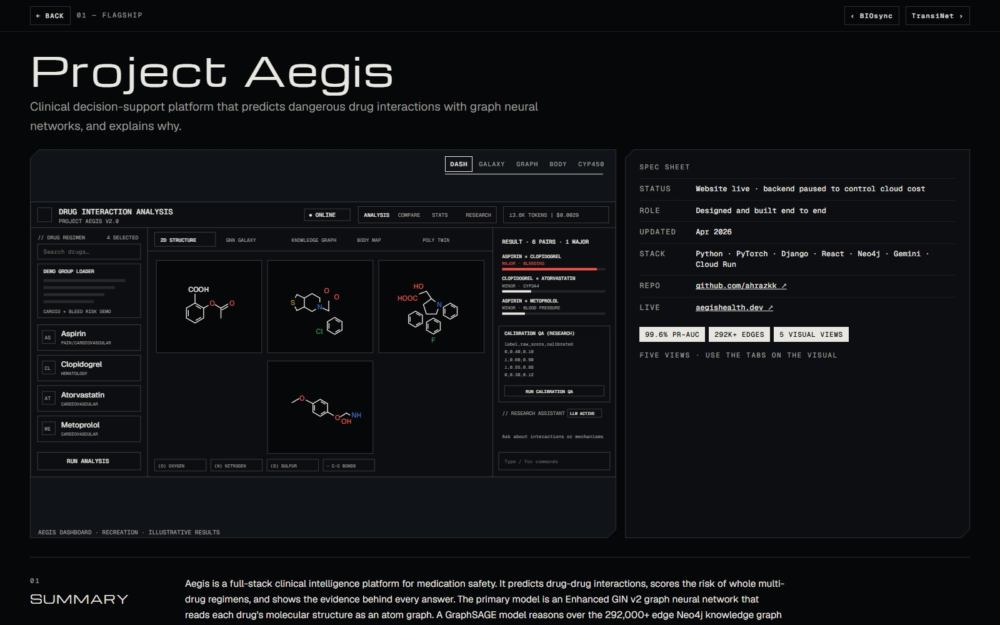

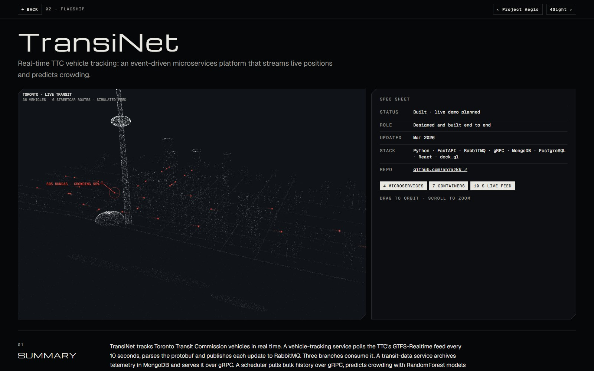

### Generated system design

The diagrams are generated from data. Each project lists its nodes, edges and a deployment band in `data.js`, and `archSVG()` lays them out on a grid and animates the data flow along the edges.

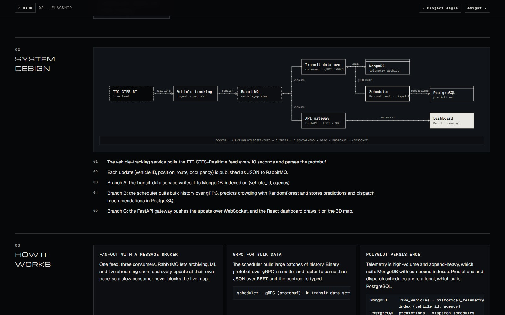

### Perception view and theory

4Sight shows what the device would understand: walkable area, tracked objects with distance and time to contact, a top-down radar and the voice line. With headphones on, "Hear the scene" plays each object from where it is, using Web Audio HRTF panning. Project pages also explain the theory behind the build.

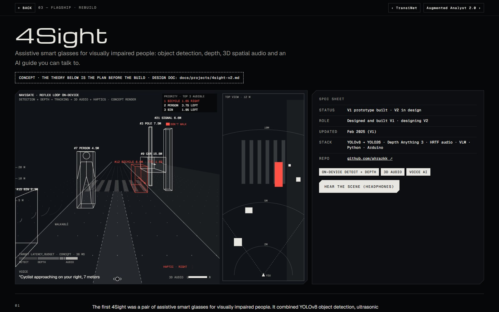

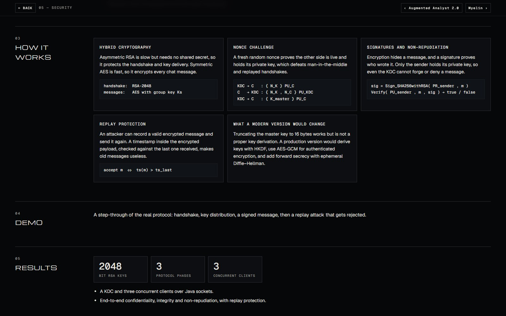

### Experience, skills and job match

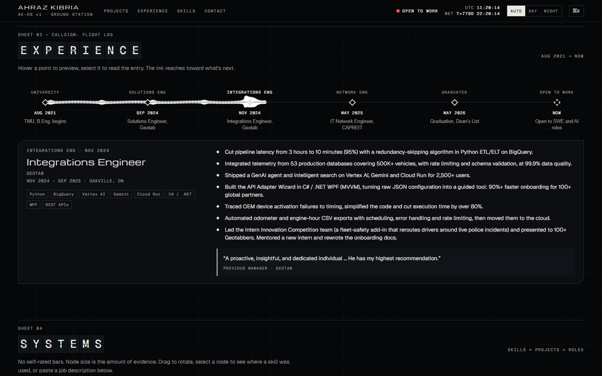

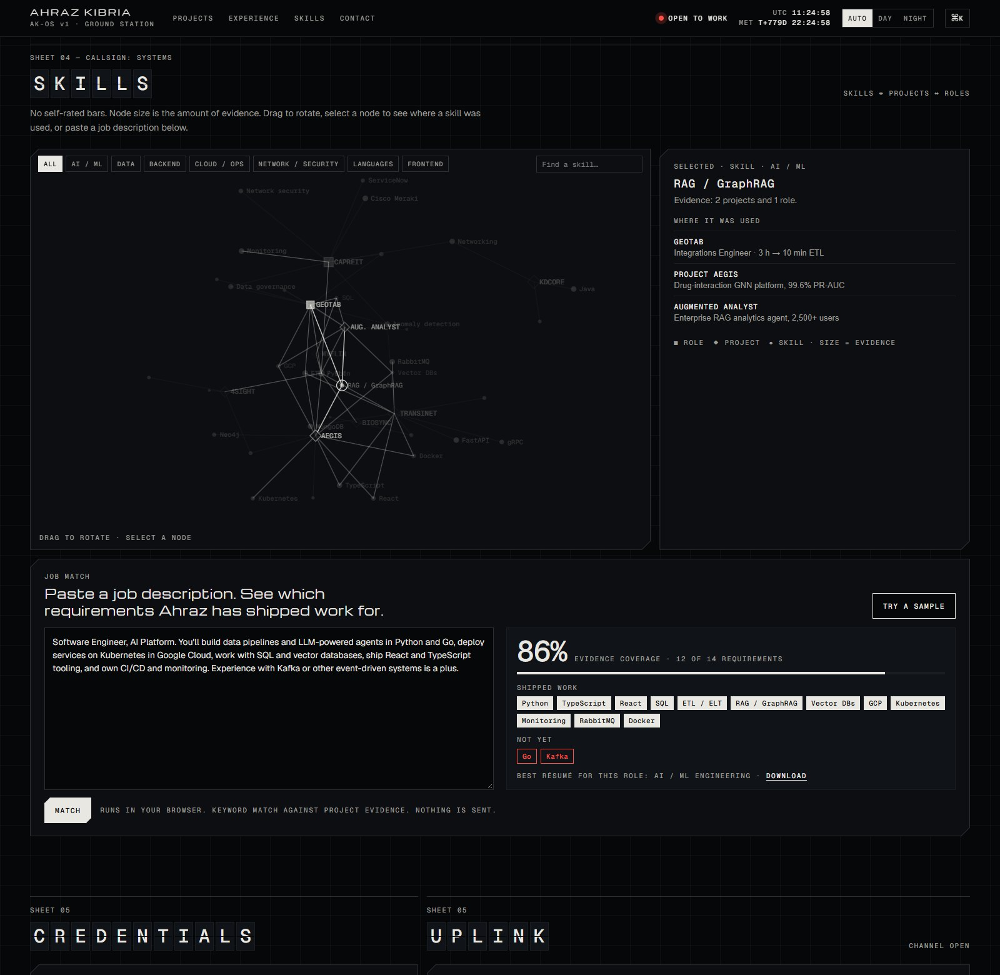

### Mobile

<p align="center">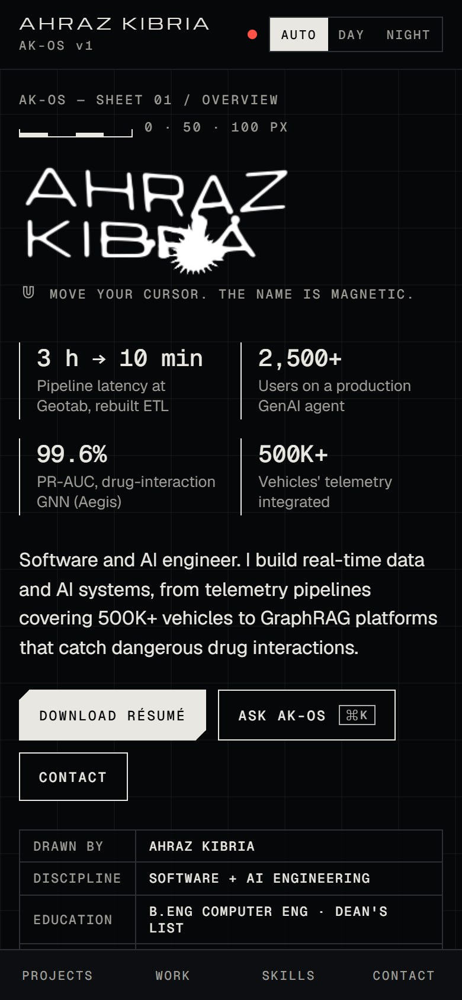</p>

---

## How it works

### The liquid metal

`liquid.js` draws a single full-screen triangle and does all the work in one fragment shader. Each pixel sums a metaball field from dozens of blobs (capped by the GPU's uniform limit), passed as a `vec4` array of position, radius and spikiness:

```
f(p) = Σ rᵢ² / (|p − bᵢ|² + 1)  +  1.7 · T(q)
```

`T` is the name, rasterized once to a canvas and blurred with a shadow, so the letters become a soft field the blobs can merge into. `q` is the pixel position pushed toward the magnet by a Gaussian, which is what makes the letters lean toward your cursor. The edge is a `smoothstep` around a threshold, with its width set from the analytic gradient of the field, so it stays anti-aliased at any scale. The same gradient gives a surface normal for the optional satin and chrome looks.

The magnet's spikes modulate its radius by angle, `r · (1 + w·|cos(11θ + t)|⁶)`. The magnet's size, pull radius and droplet size all scale with the name's width, so the effect reads the same on a phone and on an ultrawide monitor.

### One frame loop, only for what's visible

Every animated element registers with a shared loop in `core.js`. Visibility is tracked by polling element rectangles on scroll and every 200 ms, rather than with `IntersectionObserver`, which misreported elements during the clip-path reveal animations. Anything off screen stops drawing. Canvases render at reduced resolution where the eye can't tell the difference.

### Start-up

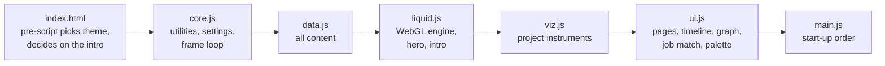

The scripts are plain classic scripts loaded in order and sharing globals. That keeps the site free of tooling while it's a single page.

### Respectful defaults

- The intro plays once per browser session. It is skipped for reduced-motion users, for bots and when someone opens a project link directly.
- `prefers-reduced-motion` turns every animation into a static frame.
- Keyboard: `⌘K`/`Ctrl+K` or `/` for the palette, `T` for theme, `Esc` to close, and arrow keys in lists.
- No cookies, no trackers and no third-party scripts. The only external requests are Google Fonts.
- Without WebGL the site falls back to plain text and still works.

---

## Project structure

```
site/                  the website (deploy this folder)
  index.html           markup and the pre-paint theme/intro script
  css/app.css          all styles: tokens, themes, layout, components
  js/core.js           utilities, settings, shared frame loop, visibility
  js/data.js           ALL content: projects, experience, skills, résumés, contact
  js/liquid.js         WebGL metaball engine, magnetic hero, intro sequence
  js/viz.js            project visualizations (Aegis, TransiNet, 4Sight, …)
  js/ui.js             project pages, system-design diagrams, experience,
                       skills graph, job match, palette, design lab
  js/main.js           start-up order
docs/
  projects/            design docs for 4Sight V2 and Augmented Analyst 2.0
  images/              README screenshots
```

---

## Run it locally

The page loads several script files, so serve it over HTTP rather than opening the file directly:

```bash
python -m http.server 8765 --directory site
```

Then open <http://localhost:8765>.

Useful URLs:

- `http://localhost:8765/#project/transinet` opens a project page directly.
- `http://localhost:8765/?lab` opens the hidden Design Lab, a panel for trying fonts, accents, liquid styles and layout widths. It's for development only. Visitors always get the approved design.

---

## Editing content

Everything a visitor reads lives in [`site/js/data.js`](site/js/data.js):

- **`P`**: one entry per project. It holds the card fields (`name`, `line`, `metrics`, `stack`, `badge`) and the page sections (`summary`, `caps`, `arch`, `flow`, `theory`, `tiles`, `results`, `decisions`, `next`). The `arch` object lists `nodes` as `[id, label, sub, col, row, kind]` and `edges` as `[from, to, label, dashed]`. The diagram is generated from these.
- **`EV`**: the experience timeline.
- **`LINKS`**, **`CAT`**: the skills graph, mapping each project or role to the skills it proves.
- **`RESUMES`**: résumé versions. Put the PDFs in `site/resumes/` named `Ahraz_Kibria_<f>.pdf` (for example `Ahraz_Kibria_Software_Engineering.pdf`). A version without its own PDF downloads the Software Engineering one.
- **`CONTACT`**: `email` powers the contact form (it opens the visitor's mail app) and the EMAIL link. Set `form` to a [Formspree](https://formspree.io) endpoint to send messages without a mail app.

---

## Deploying

The site is static, so any static host works. The plan is **Vercel**:

1. Import this repository at [vercel.com/new](https://vercel.com/new).
2. Set the **Root Directory** to `site`. There is no build command or output directory.
3. Every push to `main` deploys, and every branch gets a preview URL.

---

## Roadmap

- [x] Design v3: liquid hero, live project instruments, system-design pages, evidence graph, job match
- [x] Real content from each project's repository, shareable project links, mobile pass
- [ ] Launch: domain, résumé PDFs, contact form endpoint, security headers, analytics without cookies
- [ ] v2: move to Next.js, add an admin panel ("Ground Control") that pulls updates from GitHub, and ship **Ask AK-OS**, an assistant that answers from published content with sources
- [ ] Build 4Sight V2 and Augmented Analyst 2.0 from their design docs

---

## Credits

Typefaces: [Geist and Geist Mono](https://vercel.com/font) by Vercel, and [Michroma](https://fonts.google.com/specimen/Michroma) by Vernon Adams, served by Google Fonts. Everything else is written from scratch.

The code is public so it can be reviewed. The content, writing and design are © 2026 Ahraz Kibria.

**Ahraz Kibria** · [GitHub](https://github.com/ahrazkk) · [LinkedIn](https://www.linkedin.com/in/ahrazkibria)
