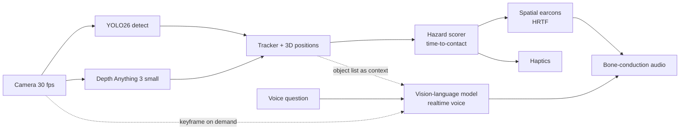

# 4Sight v2 — Design Doc

> Status: **concept, build after the website launches** (2026-10-25). Owner: Ahraz Kibria.
> The website presents this as "Concept · in build". Be honest on the site about what exists and what's planned.

## 1. Problem
About 2.2 billion people have some vision impairment, and about 43 million are blind (WHO figure, via a 2026 buyer's guide). Most assistive tech handles *near tasks* well (reading, magnification). **Navigating a street in real time** is still the gap: obstacles, cyclists, curbs, crosswalk signals, doors.

## 2. What v1 was
A wearable camera, YOLOv8 object detection in Python, an Arduino, and the idea of 3D sound plus an AI voice. It stalled early: high latency, no depth, and speech that would have flooded the user.

## 3. What changed since v1
| Then | Now (2026) | Why it matters |
|---|---|---|
| YOLOv8 + NMS post-processing | **YOLO26**: NMS-free end-to-end, built for edge, exports to ONNX/TensorRT/CoreML/TFLite with INT8/FP16 | Lower and more predictable latency on phones and Jetson |
| No depth | **Depth Anything 3 (small)**: monocular depth with Core ML / Qualcomm / Jetson builds | Real distances from one camera, so time-to-contact can be computed |
| Scripted speech | **Vision-language models with realtime voice** | Users can *ask* ("is the door open?", "read that sign") |
| Earbuds block hearing | **Bone-conduction / open-ear audio** is standard on assistive glasses | Traffic sounds stay audible, which is a safety requirement |
| Custom board | Phones with NPUs (some with LiDAR), Jetson Orin Nano, Raspberry Pi 5 + Hailo | Prototype on a phone first, build hardware later |

## 4. Product principles
1. **Hazards never wait on the cloud.** Safety cues are computed on-device. Cloud AI is only for questions and descriptions.
2. **Sound before speech.** Use spatial *earcons* (short tones placed in 3D) for objects. Speak only about changes, hazards, or answers.
3. **Ears stay open.** Bone-conduction audio only.
4. **Private by default.** Process on-device. No recording. Blur faces in anything that leaves the device.
5. **Built with blind users, not for them.** Co-design and test with the community (e.g. CNIB in Toronto) from milestone 0.
6. **An aid, not a replacement.** It complements the white cane or guide dog. Say so everywhere.

## 5. Architecture: two loops

**Reflex loop (on-device, target under 150 ms from camera to ear)**
- Detection and depth run in parallel on the NPU or GPU.
- The tracker (e.g. ByteTrack) fuses boxes with depth to get each object's 3D position and velocity.
- The hazard score combines time-to-contact, object class, whether it's on the walking path, and closing speed. Hysteresis stops the cues from chattering on and off.
- Output is one earcon per tracked object:
  - Pitch encodes the class.
  - Repetition rate encodes distance.
  - HRTF placement encodes direction.
  - Timbre encodes urgency.

**Reasoning loop (on demand, 1–3 s)**
- Push-to-talk or a wake word. The VLM gets a keyframe plus the tracked object list, so its answers are grounded.
- Modes: *Describe* (scene), *Read* (OCR, signs, menus), *Find* (door, seat, crosswalk button), *Navigate* (turn-by-turn from map + vision).
- **Familiar places:** place embeddings recognize "home", "office" or "clinic entrance" and load the labels the user saved.

## 6. Audio design (the hard part)
- **Earcon vocabulary:**
  - Person: soft sine
  - Cyclist or vehicle: brighter square tone, with urgency rising
  - Pole or obstacle: low pulse
  - Crosswalk / signal: two-tone chime
- **Budget:** at most 3 concurrent objects audible, ranked by hazard score. Everything else stays silent.
- **Speech rules:** speak only on new hazards, state changes ("signal is now walk"), or answers. Never narrate continuously.
- **Quiet mode:** only hazards are announced.

## 7. Hardware path
| Phase | Hardware | Why |
|---|---|---|
| A | Phone on a chest mount + bone-conduction headphones | Fastest path, phone NPUs are strong enough, no custom hardware |
| B | Glasses-frame camera + compute puck (Jetson Orin Nano or Pi 5 + Hailo) + haptic wristband | Hands-free, real wearable |
| C | Custom glasses | Only if A and B prove out |

## 8. Evaluation
- **Latency:** camera-to-ear P50 and P95 for hazard cues, measured on device.
- **Perception:** hazard-class recall at 2, 5 and 10 m, plus false alerts per minute, measured on a recorded-walk dataset (Toronto sidewalks, consented, faces blurred).
- **Human:** obstacle-course completion time and contact count versus the cane alone, plus perceived workload (NASA-TLX). Run with blind participants and an ethics review.
- **Reasoning:** VLM answer accuracy on a fixed question set per scene type.

## 9. Tech stack
Python + PyTorch (fine-tuning on sidewalk classes) · ONNX → Core ML / TFLite / TensorRT · Swift or Kotlin app (phase A) · ByteTrack · Web Audio / Resonance-style HRTF · a VLM with realtime voice (model-agnostic) · **web demo:** ONNX Runtime Web + WebGPU + Web Audio `PannerNode` (HRTF).

## 10. Milestones
- **M0:** interviews with 5+ blind or low-vision users, plus a hazard taxonomy.
- **M1:** reflex loop on a phone (detection + depth + tracker), with latency logged.
- **M2:** earcon vocabulary v1 and the first user sessions.
- **M3:** reasoning loop (describe / read / find).
- **M4:** wearable (phase B).
- **M5:** pilot with a community partner.

## 11. Risks
Safety liability (scope it as an aid, never as a replacement) · battery and heat on phones · false alerts causing users to tune out · privacy of bystanders · over-reliance.

## 12. How it appears on the website
- **Card:** an autopilot-style perception view with a point-cloud sidewalk, 3D boxes with distances, sound waves travelling to the listener, a stereo meter and a live voice transcript.
- **Project page:** a **"Hear the scene"** button plays HRTF-placed earcons in the browser, so visitors with headphones hear objects where they are. Later, real in-browser detection on a sample street video.
- **Labels:** "Concept · in build". Show v1 honestly as the origin.

## Sources
- [Best AI Glasses for Blind 2026 (Global Sources)](https://www.globalsources.com/knowledge/ai-glasses-for-blind-hks/)
- [Smart glasses for the blind, 2026 (Dymesty)](https://dymesty.com/de/blogs/articles/smart-glasses-for-the-blind)
- [.lumen forehead-worn navigation, CES 2026 (Interesting Engineering)](https://interestingengineering.com/photo-story/forehead-glasses-let-blind-people-navigate)
- [Meta glasses for low vision, study registration (Epistemonikos)](https://www.epistemonikos.org/en/documents/3a0ad52ced66e332566878c60a3cd578018d90b9)
- [YOLO26 benchmarking (arXiv 2509.25164)](https://arxiv.org/abs/2509.25164v1)
- [YOLO26 edge-first overview (Datature)](https://datature.io/blog/yolo26-the-edge-first-evolution-of-real-time-object-detection)
- [Depth Anything 3 on Qualcomm AI Hub](https://aihub.qualcomm.com/mobile/models/depth_anything_v3)
- [Depth Anything 3 Core ML conversion](https://huggingface.co/mlboydaisuke/Depth-Anything-3-Base-CoreML)
