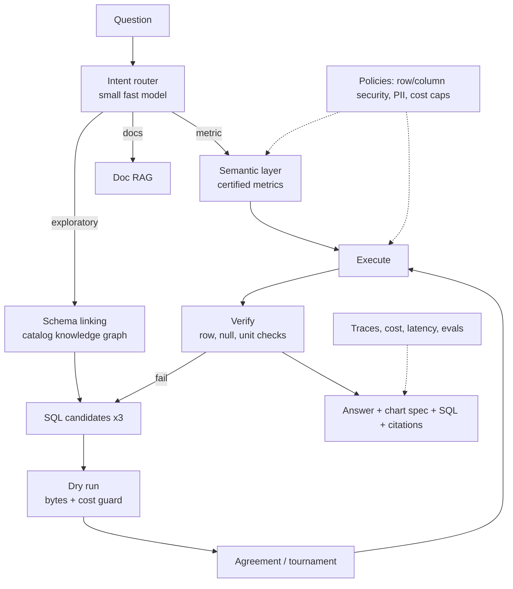

# Augmented Analyst 2.0 — Design Doc

> Status: **concept, open rebuild after the website launches** (2026-10-25).
> **Rule:** no Geotab code or data. V2 is built from scratch on synthetic or public data. The site labels it "Concept rebuild · synthetic data", inspired by V1 at Geotab.

## 1. V1 (what was shipped at Geotab)
An enterprise RAG system with vector search and an AI agent. It automated knowledge discovery and SQL analytics across TB+ of BigQuery tables for **2,500+ users**, with automated model evaluation, guardrails and multi-model fallback, served from a Flask REST API.

## 2. Why rebuild it
The 2026 state of the art moved in three ways:
1. **Semantic layer first.** Agents pick certified metrics instead of inventing SQL against raw tables, and access rules are enforced when the query is compiled, not in the prompt.
2. **Test-time scaling for SQL.** Top BIRD results (e.g. Agentar-Scale-SQL at 81.67% execution accuracy) generate several candidates, refine them, and pick by agreement or tournament.
3. **Execution-guided self-correction.** Run the query, inspect errors and empty results, and retry. This is cheap and reliable.

BIRD itself has caveats: hand-written hints and some wrong gold SQL. So V2 is judged on **its own eval set**, not leaderboard numbers.

## 3. Architecture

| Component | Design |
|---|---|
| **Intent router** | A cheap model classifies each question as metric, exploratory SQL, docs, or out-of-scope (refuse). |
| **Semantic layer** | Cube or the dbt Semantic Layer. Certified fleet metrics include `idle_hours`, `harsh_brake_rate`, `fuel_per_100km`, `utilization` and `overdue_service`. Most questions should land here. |
| **Catalog knowledge graph** | Tables, columns, join paths, metric definitions, glossary terms and verified example queries, stored as a graph. Schema linking is **GraphRAG over the catalog**. This reuses the Aegis expertise. |
| **SQL generation** | Three candidates with different strategies (direct, decomposed, example-guided). Each is dry-run first. BigQuery's dry run returns bytes scanned, which is used as the cost guard. |
| **Selection** | Execute the cheap candidates on a sample and pick by result agreement. Ties go to a judge model. |
| **Verification** | Sanity checks on row counts, null ratios, units and time windows. The agent also restates the answer in plain language ("explain-back"), and a confidence score is shown to the user. |
| **Answer** | A Vega-Lite chart spec, a short narrative, the SQL, and lineage citations naming each metric or table used. |
| **Governance** | Row- and column-level policies enforced in the query layer, PII redaction, a cost cap per query and per user, and an audit log. |
| **Learning loop** | Thumbs up/down feeds curated examples back into retrieval. Frequent ad-hoc queries get promoted to certified metrics. |
| **Model routing** | Small model for routing, strong model for SQL, a fallback chain, and a semantic cache. The design is model-agnostic. |
| **Interfaces** | Web UI, Slack, and an **MCP server** exposing `query_metric` / `run_sql` so other agents can use it. |
| **Observability** | OpenTelemetry trace per step, plus cost, latency and accuracy dashboards. |

## 4. Data (all free)
- **Synthetic fleet warehouse generator** (Python): vehicles, depots, trips, GPS pings, engine hours, odometer, fault codes and service logs. Generate tens of millions of rows with realistic seasonality and anomalies.
- **Hosting:** the BigQuery sandbox (free tier) or DuckDB/MotherDuck locally. The same SQL dialect constraints are documented.
- **Optional public data:** the Chicago taxi trips and NYC TLC datasets on BigQuery public datasets.

## 5. Evaluation (run in CI)
- **Golden set:** about 200 question → SQL/answer pairs over the synthetic schema, with easy / medium / hard and adversarial tiers (ambiguous, out-of-scope, prompt-injection).
- **Metrics:**
  - Execution accuracy
  - Semantic-layer hit rate
  - Cost per answer
  - P95 latency
  - Refusal correctness
  - Citation correctness
- **Regression:** every PR shows the eval delta. The site's `/system` page shows the latest scores.

## 6. Stack
Python (FastAPI) · an agent framework (e.g. Pydantic AI) · BigQuery / DuckDB · Cube or dbt Semantic Layer · Neo4j or Postgres for the catalog graph · pgvector · Vega-Lite · Next.js UI · OpenTelemetry · MCP.

## 7. Milestones
- **M0:** synthetic data generator + schema + 10 certified metrics.
- **M1:** semantic-layer path end to end, with charts.
- **M2:** catalog graph + multi-candidate SQL + dry-run cost guard + verification.
- **M3:** eval set in CI + traces + dashboards.
- **M4:** MCP server + Slack + public demo (replay mode on the website, plus a live sandbox with rate limits).

## 8. How it appears on the website
- **Card:** a live agent trace. The question is typed in, then seven steps tick through (route → link schema → semantic layer → SQL ×3 → dry run with real bytes and dollar cost → verify → answer), and the chart builds.
- **Project page:** the same trace, larger, with the SQL visible.
- **Labels:** "Concept rebuild · synthetic data". V1 facts (2,500+ users) are stated as V1.

## Sources
- [Agentar-Scale-SQL: orchestrated test-time scaling (arXiv 2509.24403)](https://arxiv.org/html/2509.24403v1)
- [BAPPA: benchmarking agents, plans and pipelines for text-to-SQL (arXiv 2511.04153)](https://arxiv.org/pdf/2511.04153)
- [ReViSQL (arXiv 2603.20004)](https://arxiv.org/abs/2603.20004v1)
- [The BIRD benchmark vs real databases (Beancount research log)](https://beancount.io/bean-labs/research-logs/2026/06/06/bird-benchmark-text-to-sql-real-database-gap)
- [Semantic layer architecture (Cube)](https://cube.dev/articles/semantic-layer-architecture)
- [Semantic layers for enterprise AI agents (Sema4.ai)](https://sema4.ai/blog/semantic-layers-enterprise-ai-agents/)
- [Semantic layer for agentic AI on AWS (AWS ML blog)](https://aws.amazon.com/blogs/machine-learning/build-a-semantic-layer-for-agentic-ai-on-aws-with-stardog-and-amazon-bedrock-agentcore/)
